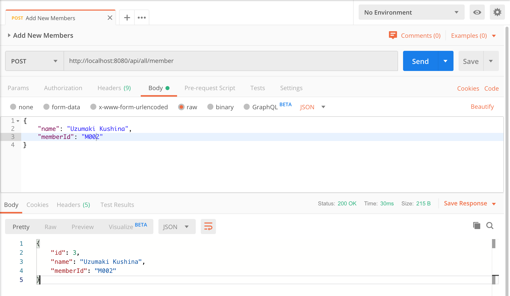
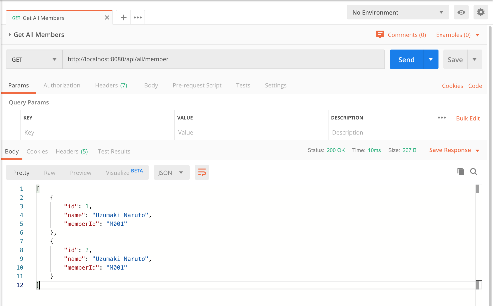
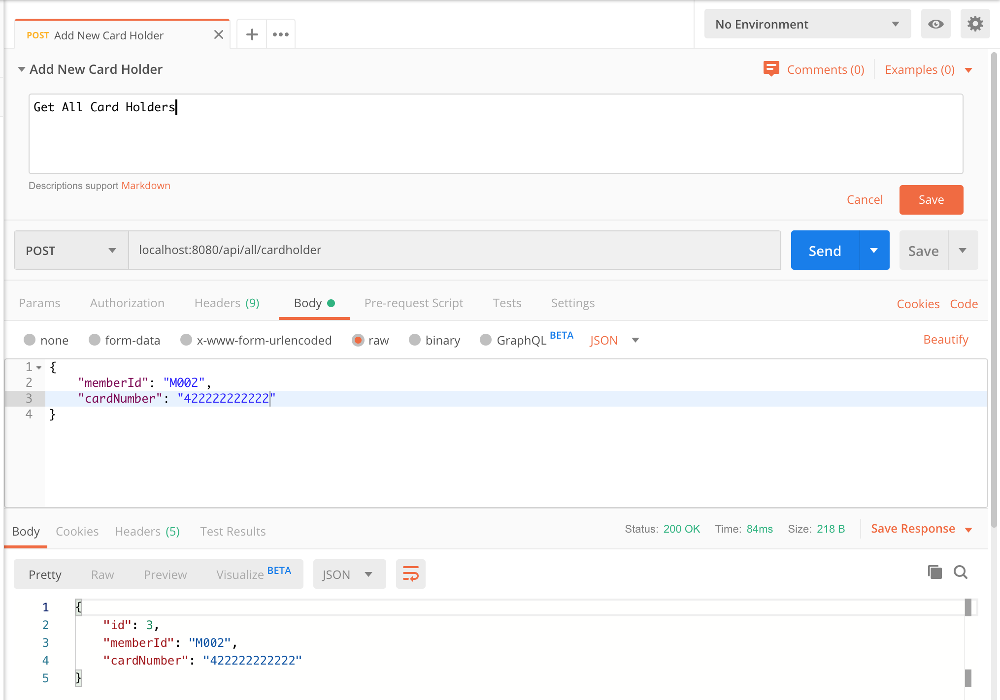
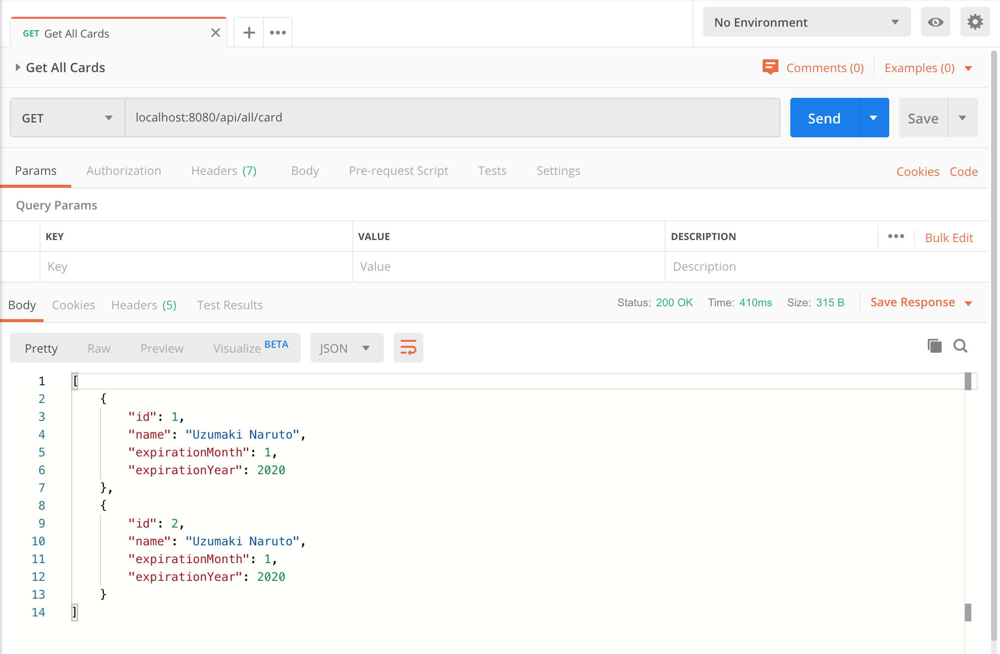
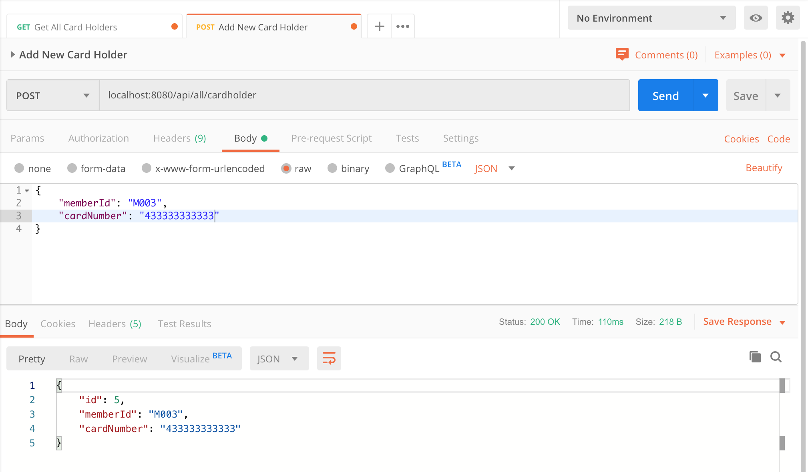
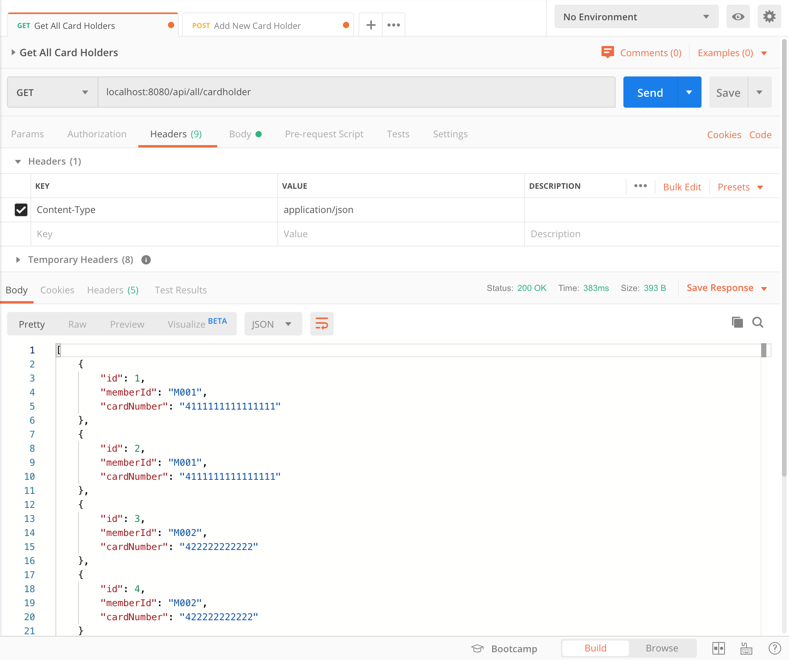

# springboot-multipledatasources

[](https://github.com/hendisantika/springboot-multipledatasources/actions/workflows/maven.yml)


Demo project for using **multiple datasources** in a Spring Boot application. Each domain is stored in its own MySQL
database, with its own `DataSource`, `EntityManagerFactory` and `TransactionManager`.

| Domain      | Database       | Connection pool | Configuration class                 |
|-------------|----------------|-----------------|-------------------------------------|
| Member      | `memberDB`     | HikariCP        | `MemberDataSourceConfiguration` (`@Primary`) |
| Card Holder | `cardholderDB` | Commons DBCP    | `CardHolderDataSourceConfiguration` |
| Card        | `cardDB`       | Commons DBCP    | `CardDataSourceConfiguration`       |

## Tech Stack

- Java 25
- Spring Boot 4.2.0 (Spring Web MVC, Spring Data JPA, Validation)
- Hibernate / Jakarta Persistence
- MySQL (`com.mysql:mysql-connector-j`)
- Lombok
- JUnit 5
- Maven Wrapper (Maven 3.9.16)

## Prerequisites

- JDK 25
- MySQL 8.x running on `localhost:3306` with user `root` / password `root`
  (databases are created automatically thanks to `createDatabaseIfNotExist=true`)

Quick way to start MySQL using Docker:

```shell
docker run -d --name mysql-multids -p 3306:3306 -e MYSQL_ROOT_PASSWORD=root mysql:8.4
```

Adjust credentials in [`application.properties`](src/main/resources/application.properties) if needed.

## Things to do

1. Clone this repository: `git clone https://github.com/hendisantika/springboot-multipledatasources.git`
2. Go to the folder: `cd springboot-multipledatasources`
3. Run the application: `./mvnw clean spring-boot:run`
4. Open REST API Client tool such as [POSTMAN](https://www.postman.com/).

Run the tests (requires the MySQL instance above):

```shell
./mvnw clean verify
```

## REST Endpoints

Base URL: `http://localhost:8080/api/all`

| Method | Endpoint      | Description            |
|--------|---------------|------------------------|
| POST   | `/member`     | Add new member         |
| GET    | `/member`     | Get all members        |
| POST   | `/cardholder` | Add new card holder    |
| GET    | `/cardholder` | Get all card holders   |
| POST   | `/card`       | Add new card           |
| GET    | `/card`       | Get all cards          |

Example:

```shell
curl -X POST http://localhost:8080/api/all/member \
  -H "Content-Type: application/json" \
  -d '{"memberId":"M001","name":"Uzumaki Naruto"}'

curl -X POST http://localhost:8080/api/all/cardholder \
  -H "Content-Type: application/json" \
  -d '{"memberId":"M001","cardNumber":"4111111111111111"}'

curl -X POST http://localhost:8080/api/all/card \
  -H "Content-Type: application/json" \
  -d '{"name":"Uzumaki Naruto","expirationMonth":1,"expirationYear":2030}'
```

## CI/CD & Dependency Updates

- **GitHub Actions** ([`maven.yml`](.github/workflows/maven.yml)): builds & tests on JDK 25 (Temurin) against a MySQL
  8.4 service container on every push / pull request to `master`, then submits the Maven dependency graph.
- **Dependabot** ([`dependabot.yml`](.github/dependabot.yml)): daily Maven updates (grouped: Spring Boot, Maven plugins,
  other minor/patch) and weekly GitHub Actions updates, labelled and prefixed with conventional commit messages.

## Screen shot

**Add New Member**



**Get All Members**



**Add New Card**



**Get All Cards**



**Add New Card Holder**



**Get All Card Holders**



## Conclusion

When dealing with just one datasource and Spring Boot, data source configuration is simple. Spring Boot can provide a lot
of auto configuration.

However, if you need to connect to multiple datasources with Spring Boot, additional configuration is needed.

You need to provide configuration data to Spring Boot, customized for each data source.
